# Awesome Image Restoration Agents

[](https://github.com/Reflection0427/Awesome-Image-Restoration-Agents/actions/workflows/validate.yml)
[](https://github.com/Reflection0427/Awesome-Image-Restoration-Agents/actions/workflows/discover-papers.yml)

A curated list of papers on **agentic image restoration**, including multimodal agents that perceive degradations, plan or learn restoration trajectories, invoke specialized tools, evaluate intermediate outputs, and adapt through reflection, memory, or reinforcement learning.

本仓库整理图像恢复 Agent 研究。表格最后一列 `Framework` 直接展示从固定版本论文 PDF 中按页裁取的作者原始 Framework / Architecture / Pipeline 图；不使用自绘图、博客截图或 AI 生成图。

**17 reviewed papers · 13 general-purpose agents · 4 domain-specific agents**

## Scope

The general-purpose section covers agents that handle multiple or unknown degradations through dynamic planning, tool use, feedback, learned policies, or evolving memory. The domain-specific section covers the same agentic pattern specialized for super-resolution, adverse-weather perception, deraining, or portrait restoration. Pure all-in-one restoration networks and prompt-conditioned models without an autonomous decision or tool-use loop are outside the core list.

## General-Purpose Image Restoration Agents

| Conference / Journal | Method | Title | Resources | Framework |
| :--- | :--- | :--- | :--- | :--- |
| **ECCV 2026** | **SEAR** | Self-Evolving Agentic Image Restoration via Deliberate Planning and Intuitive Execution | <a href="https://arxiv.org/abs/2606.28971">Paper</a> | <a href="assets/frameworks/sear.png">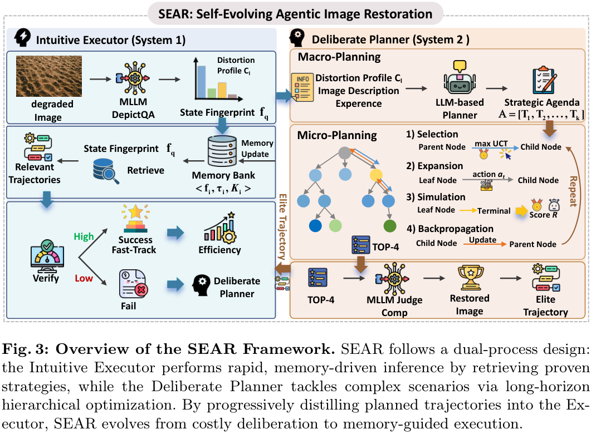</a><br><sub>Original paper figure: Figure 3 · PDF page 5 · Source: <a href="https://arxiv.org/pdf/2606.28971v2">pinned PDF</a><br>© Paper authors/publisher. All rights remain with the original owner.</sub> |
| **ECCV 2026** | **TIR-Agent** | TIR-Agent: Training an Explorative and Efficient Agent for Image Restoration | <a href="https://arxiv.org/abs/2603.27742">Paper</a> | <a href="assets/frameworks/tir-agent.png">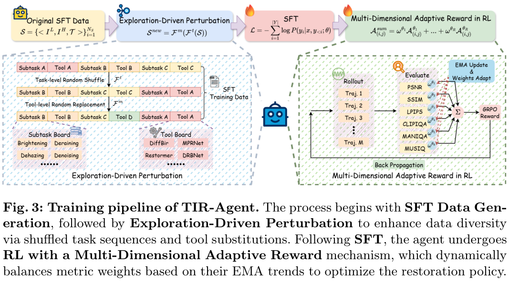</a><br><sub>Original paper figure: Figure 3 · PDF page 6 · Source: <a href="https://arxiv.org/pdf/2603.27742v2">pinned PDF</a><br>© Paper authors/publisher. All rights remain with the original owner.</sub> |
| **IJCV 2026** | **MAIR** | Multi-Agent Image Restoration | <a href="https://doi.org/10.1007/s11263-026-02792-5">Paper</a> | <a href="assets/frameworks/mair.png">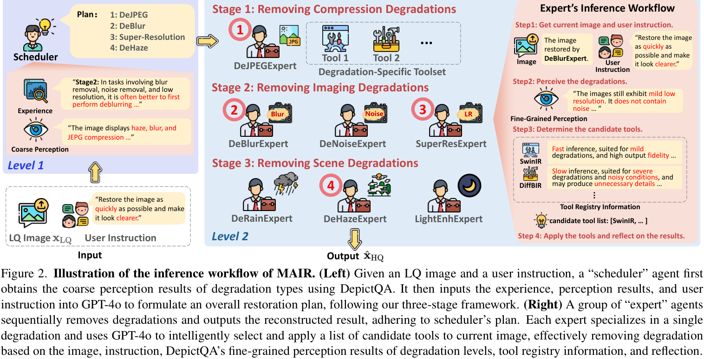</a><br><sub>Original paper figure: Figure 2 · PDF page 4 · Source: <a href="https://arxiv.org/pdf/2503.09403v2">pinned PDF</a><br>© Paper authors/publisher. All rights remain with the original owner.</sub> |
| **arXiv 2026** | **Causal-AgentIR** | Causal-AgentIR: Self-Evolving Causal Memory for Adaptive Image Restoration Agents | <a href="https://arxiv.org/abs/2607.21125">Paper</a> | <a href="assets/frameworks/causal-agentir.png">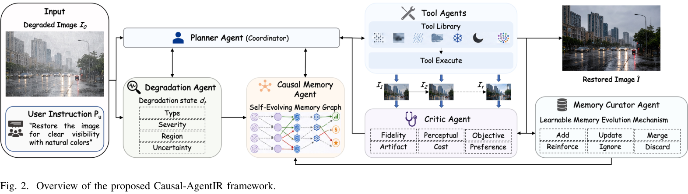</a><br><sub>Original paper figure: Figure 2 · PDF page 4 · Source: <a href="https://arxiv.org/pdf/2607.21125v1">pinned PDF</a><br>© Paper authors/publisher. All rights remain with the original owner.</sub> |
| **arXiv 2026** | **DiTTo** | DiTTo: Scalable Order-aware All-in-One Image Restoration Agent | <a href="https://arxiv.org/abs/2605.30915">Paper</a> · <a href="https://cmlab-korea.github.io/DiTTo/">Project</a> | <a href="assets/frameworks/ditto.png">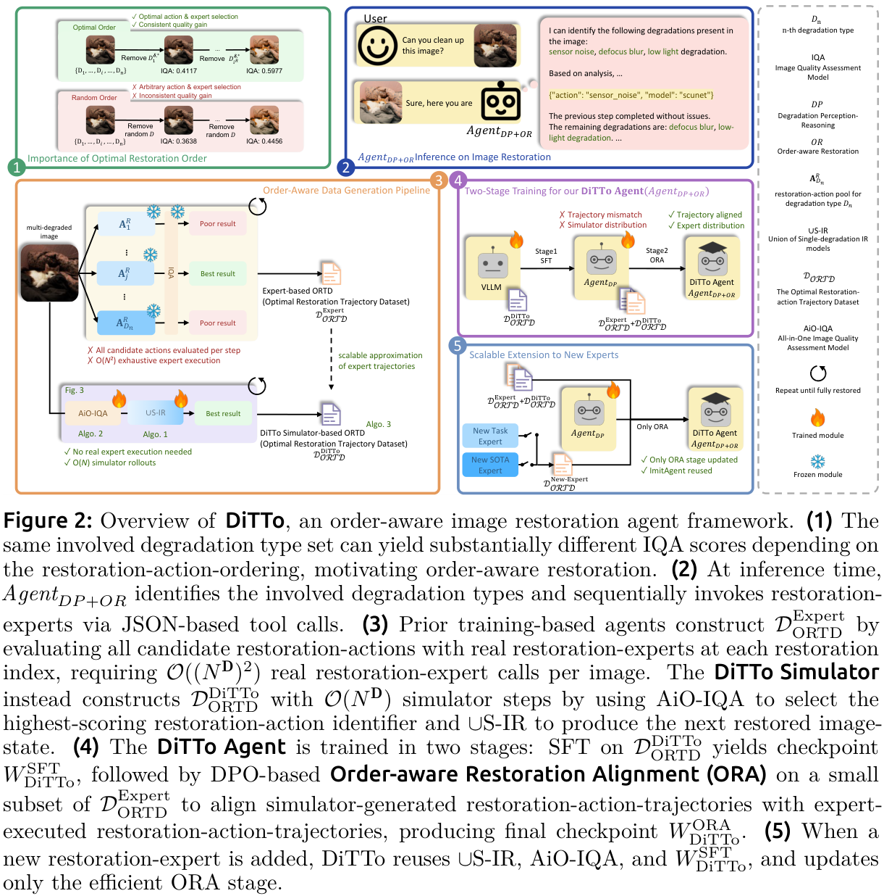</a><br><sub>Original paper figure: Figure 2 · PDF page 3 · Source: <a href="https://arxiv.org/pdf/2605.30915v2">pinned PDF</a><br>© Paper authors/publisher. All rights remain with the original owner.</sub> |
| **arXiv 2026** | **EvoIR-Agent** | EvoIR-Agent: Self-Evolving Image Restoration Agentic System via Experience-Driven Learning | <a href="https://arxiv.org/abs/2605.22208">Paper</a> · <a href="https://github.com/rightleft-123/EvoIRAgent">Code</a> | <a href="assets/frameworks/evoir-agent.png">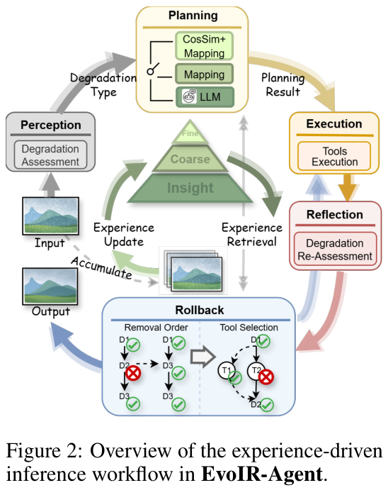</a><br><sub>Original paper figure: Figure 2 · PDF page 3 · Source: <a href="https://arxiv.org/pdf/2605.22208v3">pinned PDF</a><br>© Paper authors/publisher. All rights remain with the original owner.</sub> |
| **arXiv 2026** | **OPERA** | OPERA: An Agent for Image Restoration with End-to-End Joint Planning-Execution Optimization | <a href="https://arxiv.org/abs/2605.22104">Paper</a> · <a href="https://github.com/xsyshuishui/Opera">Code</a> | <a href="assets/frameworks/opera.png">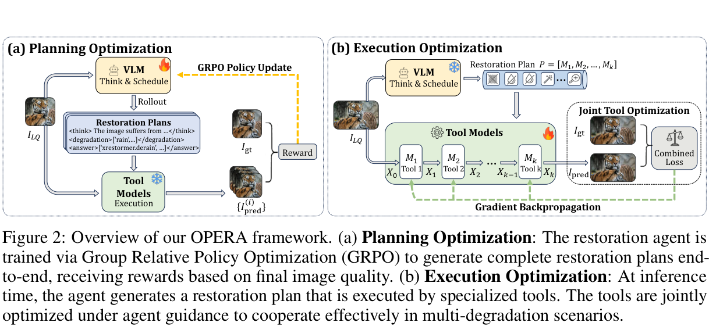</a><br><sub>Original paper figure: Figure 2 · PDF page 5 · Source: <a href="https://arxiv.org/pdf/2605.22104v1">pinned PDF</a><br>© Paper authors/publisher. All rights remain with the original owner.</sub> |
| **arXiv 2026** | **SkillIR** | SkillIR: Evolving Scene-Aware Skills for Agentic Image Restoration | <a href="https://arxiv.org/abs/2609.21468">Paper</a> | <a href="assets/frameworks/skillir.png">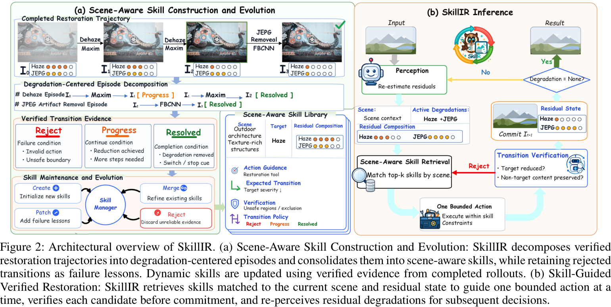</a><br><sub>Original paper figure: Figure 2 · PDF page 3 · Source: <a href="https://arxiv.org/pdf/2609.21468v1">pinned PDF</a><br>© Paper authors/publisher. All rights remain with the original owner.</sub> |
| **ICLR 2025** | **AgenticIR** | An Intelligent Agentic System for Complex Image Restoration Problems | <a href="https://arxiv.org/abs/2410.17809">Paper</a> · <a href="https://github.com/Kaiwen-Zhu/AgenticIR">Code</a> | <a href="assets/frameworks/agenticir.png">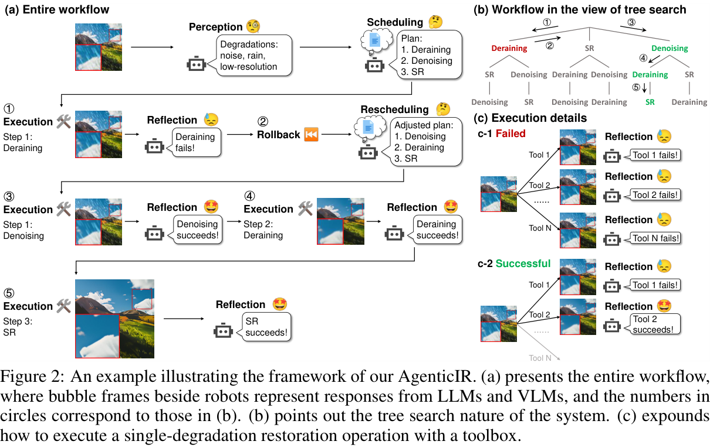</a><br><sub>Original paper figure: Figure 2 · PDF page 4 · Source: <a href="https://arxiv.org/pdf/2410.17809v2">pinned PDF</a><br>© Paper authors/publisher. All rights remain with the original owner.</sub> |
| **arXiv 2025** | **HybridAgent** | Hybrid Agents for Image Restoration | <a href="https://arxiv.org/abs/2503.10120">Paper</a> | <a href="assets/frameworks/hybridagent.png">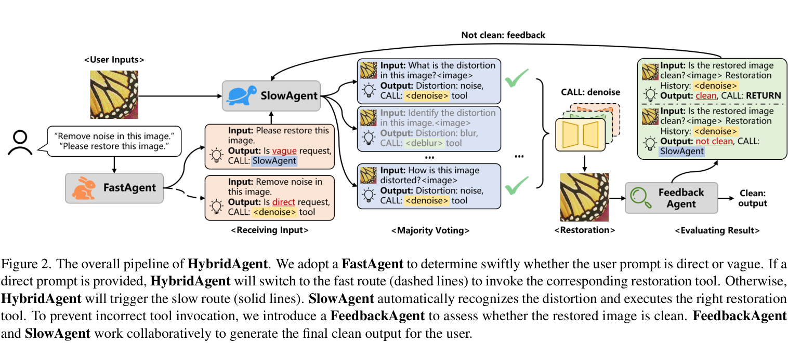</a><br><sub>Original paper figure: Figure 2 · PDF page 3 · Source: <a href="https://arxiv.org/pdf/2503.10120v1">pinned PDF</a><br>© Paper authors/publisher. All rights remain with the original owner.</sub> |
| **arXiv 2025** | **Q-Agent** | Q-Agent: Quality-Driven Chain-of-Thought Image Restoration Agent through Robust Multimodal Large Language Model | <a href="https://arxiv.org/abs/2504.07148">Paper</a> | <a href="assets/frameworks/q-agent.png">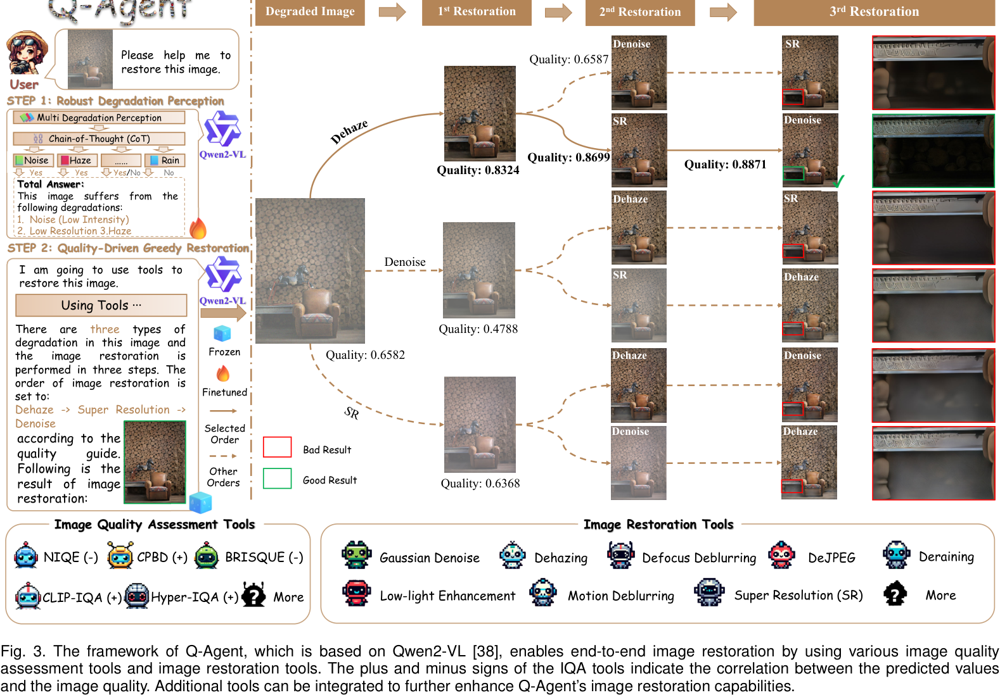</a><br><sub>Original paper figure: Figure 3 · PDF page 4 · Source: <a href="https://arxiv.org/pdf/2504.07148v2">pinned PDF</a><br>© Paper authors/publisher. All rights remain with the original owner.</sub> |
| **arXiv 2025** | **Restore-R1** | Restore-R1: Efficient Image Restoration Agents via Reinforcement Learning with Multimodal LLM Perceptual Feedback | <a href="https://arxiv.org/abs/2512.18599">Paper</a> | <a href="assets/frameworks/restore-r1.png">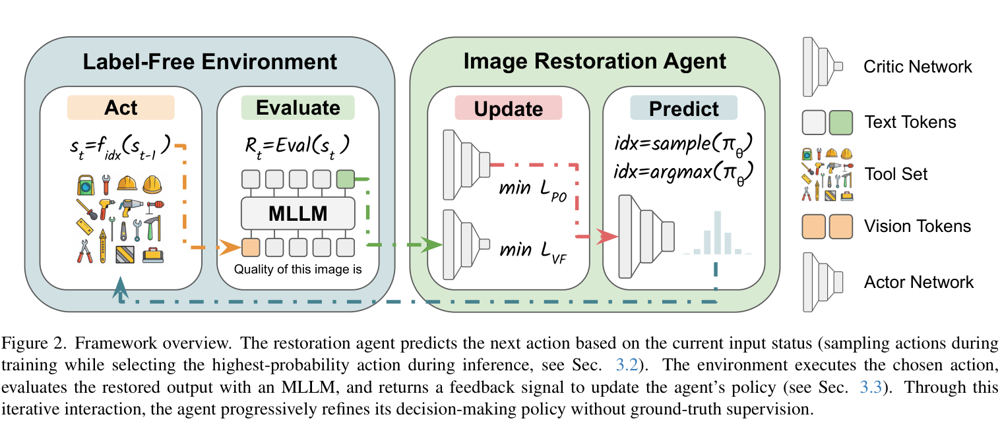</a><br><sub>Original paper figure: Figure 2 · PDF page 3 · Source: <a href="https://arxiv.org/pdf/2512.18599v2">pinned PDF</a><br>© Paper authors/publisher. All rights remain with the original owner.</sub> |
| **NeurIPS 2024** | **RestoreAgent** | RestoreAgent: Autonomous Image Restoration Agent via Multimodal Large Language Models | <a href="https://arxiv.org/abs/2407.18035">Paper</a> · <a href="https://haoyuchen.com/RestoreAgent">Project</a> | <a href="assets/frameworks/restoreagent.png">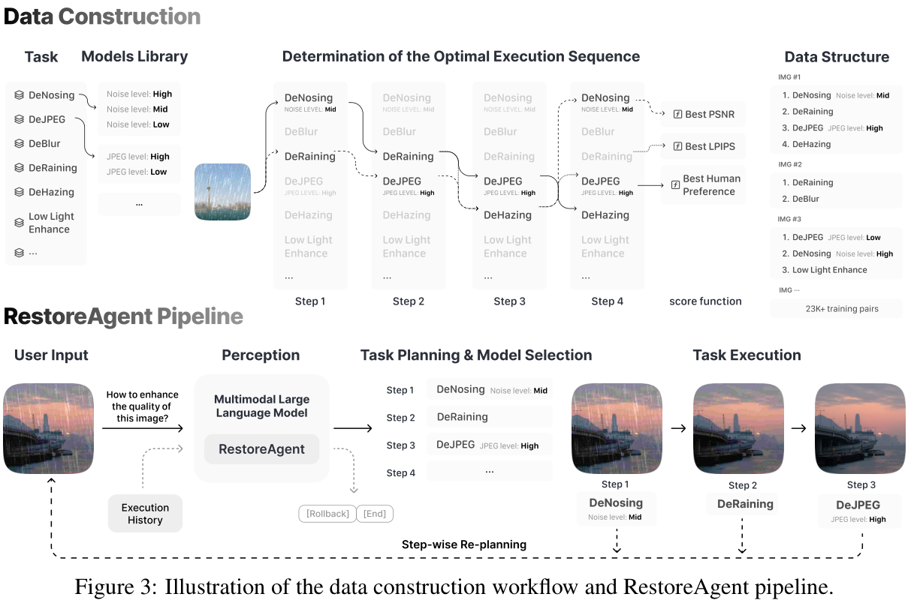</a><br><sub>Original paper figure: Figure 3 · PDF page 7 · Source: <a href="https://arxiv.org/pdf/2407.18035v1">pinned PDF</a><br>© Paper authors/publisher. All rights remain with the original owner.</sub> |

## Domain-Specific Restoration Agents

| Conference / Journal | Method | Title | Resources | Framework |
| :--- | :--- | :--- | :--- | :--- |
| **arXiv 2026** | **Derain-Agent** | Derain-Agent: A Plug-and-Play Agent Framework for Rainy Image Restoration | <a href="https://arxiv.org/abs/2603.11866">Paper</a> | <a href="assets/frameworks/derain-agent.png">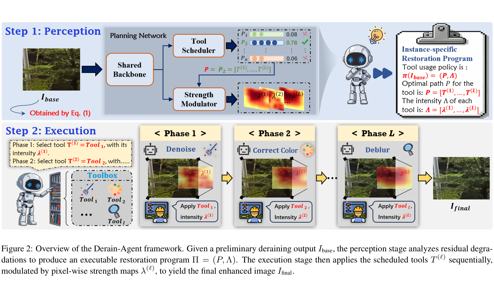</a><br><sub>Original paper figure: Figure 2 · PDF page 3 · Source: <a href="https://arxiv.org/pdf/2603.11866v1">pinned PDF</a><br>© Paper authors/publisher. All rights remain with the original owner.</sub> |
| **arXiv 2026** | **PaAgent** | PaAgent: Portrait-Aware Image Restoration Agent via Subjective-Objective Reinforcement Learning | <a href="https://arxiv.org/abs/2603.17055">Paper</a> · <a href="https://wyjgr.github.io/PaAgent.html">Project</a> | <a href="assets/frameworks/paagent.png">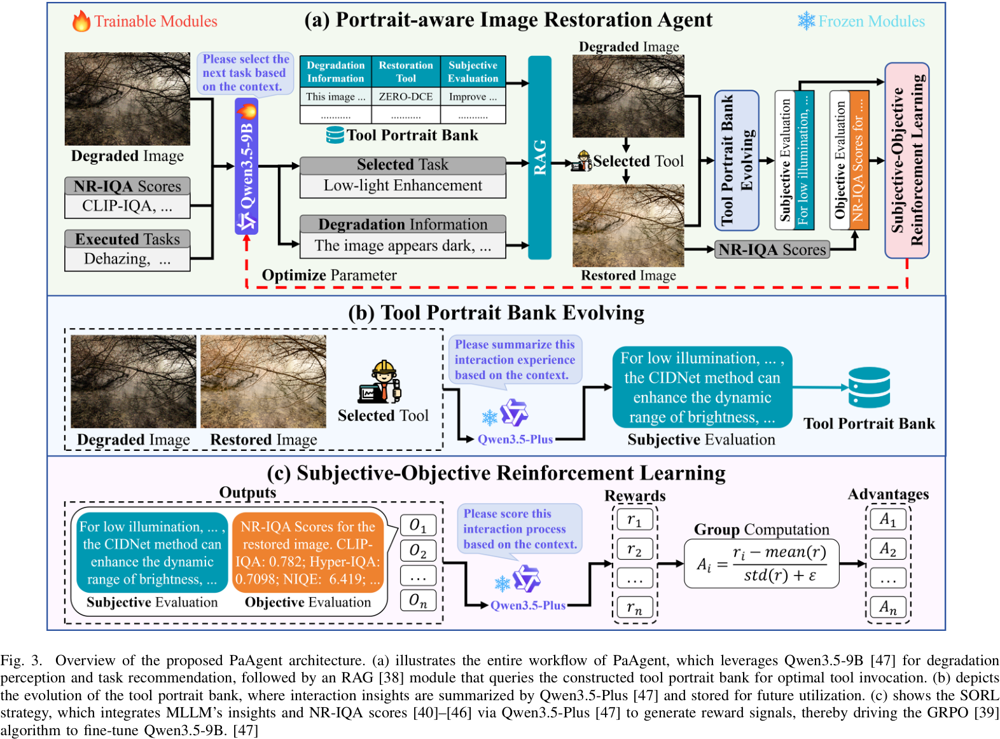</a><br><sub>Original paper figure: Figure 3 · PDF page 3 · Source: <a href="https://arxiv.org/pdf/2603.17055v1">pinned PDF</a><br>© Paper authors/publisher. All rights remain with the original owner.</sub> |
| **CVPR 2025** | **JarvisIR** | JarvisIR: Elevating Autonomous Driving Perception with Intelligent Image Restoration | <a href="https://arxiv.org/abs/2504.04158">Paper</a> · <a href="https://cvpr2025-jarvisir.github.io/">Project</a> | <a href="assets/frameworks/jarvisir.png">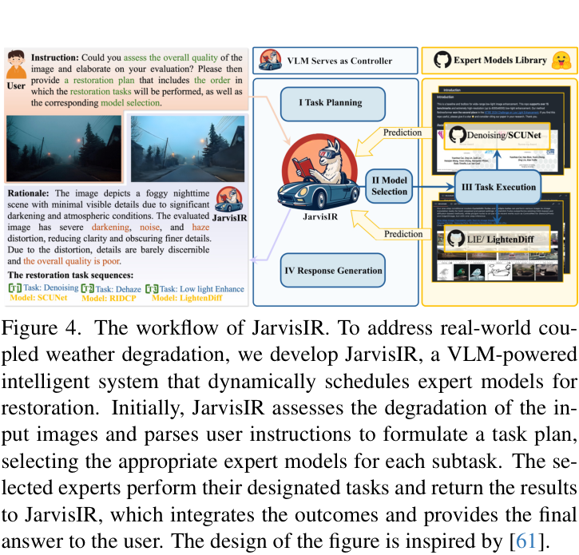</a><br><sub>Original paper figure: Figure 4 · PDF page 4 · Source: <a href="https://arxiv.org/pdf/2504.04158v1">pinned PDF</a><br>© Paper authors/publisher. All rights remain with the original owner.</sub> |
| **NeurIPS 2025** | **4KAgent** | 4KAgent: Agentic Any Image to 4K Super-Resolution | <a href="https://arxiv.org/abs/2507.07105">Paper</a> · <a href="https://4kagent.github.io">Project</a> | <a href="assets/frameworks/4kagent.png">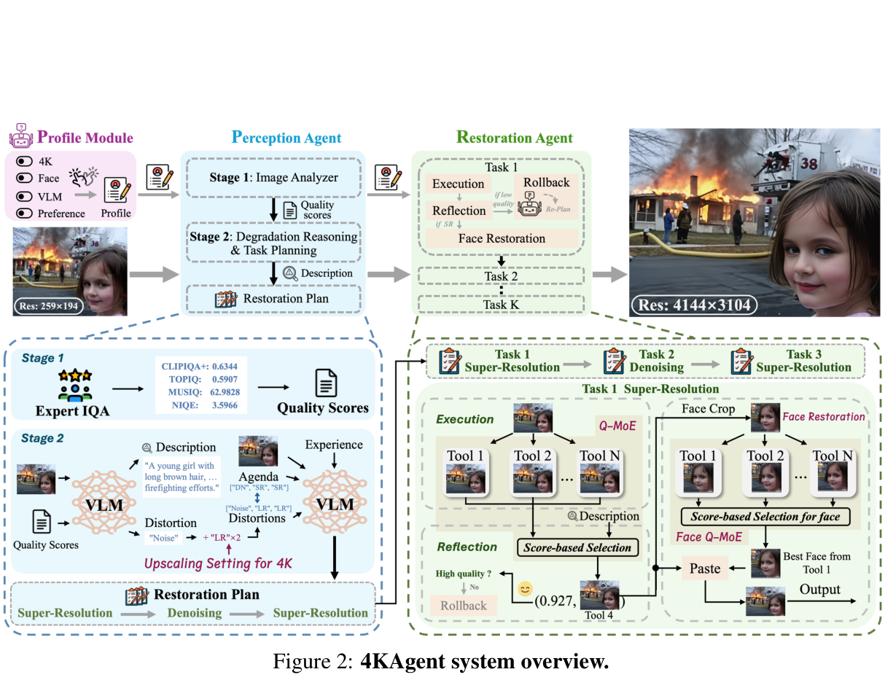</a><br><sub>Original paper figure: Figure 2 · PDF page 5 · Source: <a href="https://arxiv.org/pdf/2507.07105v1">pinned PDF</a><br>© Paper authors/publisher. All rights remain with the original owner.</sub> |

## Figure policy

Every Framework image is cropped from the linked pinned author PDF. Metadata in `data/papers.json` records the PDF URL, SHA-256, one-based page number, Figure label, and crop rectangle in PDF points. The crop preserves the paper figure and caption; only whitespace cropping and lossless PNG compression are applied. Copyright and all other rights remain with the paper authors or publishers.

Reproduce or verify all committed figures with:

```bash
python -m pip install -r requirements.txt
python scripts/extract_figure.py --all
python scripts/extract_figure.py --all --verify-only
python scripts/generate_readme.py --check
python -m unittest discover -s tests -v
```

## Automatic paper tracking

A scheduled workflow searches arXiv, OpenAlex, and Crossref every Monday and opens or updates a candidate pull request. Discovery never adds a paper to this table automatically: a reviewer must read the PDF, verify relevance and metadata, select an author-created Figure, and validate its crop before acceptance.

## Contributing

Contributions are welcome through issues and pull requests. See [the review guide](docs/PAPER_TRACKER.md).

## License

Repository code and curator-authored metadata are released under the MIT License. Paper figures remain the property of their respective authors or publishers.
